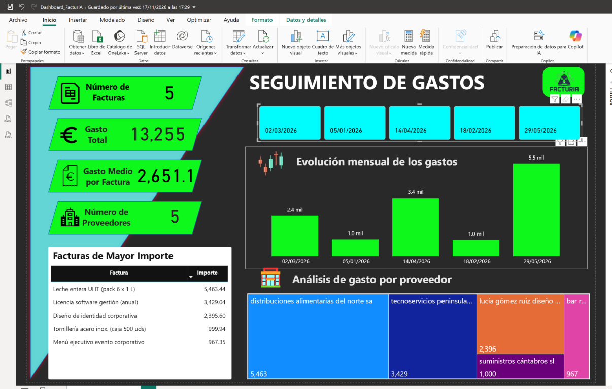

# FacturIA

FacturIA automatiza la extracción de datos de facturas en PDF y permite analizar los gastos en un dashboard de Power BI.



## ¿Qué hace?

1. Lee el texto de las facturas PDF con PyMuPDF.
2. Envía el texto a DeepSeek para extraer la fecha, el proveedor, el concepto, el importe y la moneda.
3. Procesa los resultados con pandas y convierte los importes en dólares a euros usando el tipo de conversión definido en `main.py`.
4. Guarda los datos en una base SQLite local llamada `facturas.db`.
5. Permite visualizar y explorar los gastos con el informe de Power BI incluido.

El dashboard muestra indicadores como el gasto total, el gasto medio por factura y el número de proveedores, además de la evolución de los gastos y su distribución por proveedor.

## Requisitos

- Python 3.13 (versión utilizada en `entorno.yml`).
- Una clave de API de DeepSeek.
- Power BI Desktop y un controlador ODBC compatible con SQLite para conectar el informe a la base de datos.

## Puesta en marcha

1. Clona el repositorio y entra en su carpeta.
2. Instala las dependencias:

   ```bash
   python -m pip install -r requirements.txt
   ```

3. Crea un archivo `.env` en la raíz del proyecto y añade tu clave:

   ```dotenv
   OPENAI_API_KEY=tu_clave_de_deepseek
   ```

   Aunque la variable se llama `OPENAI_API_KEY`, el cliente del proyecto está configurado para usar la API de DeepSeek.

4. Coloca los PDF dentro de subcarpetas de `facturas/`, por ejemplo:

   ```text
   facturas/
   └── 2026-01/
       └── factura.pdf
   ```

   La carpeta `facturas/` se crea localmente si no existe.

5. Ejecuta el procesamiento:

   ```bash
   python main.py
   ```

   El programa crea o actualiza `facturas.db` en la raíz del proyecto. Añade los resultados a la tabla existente; si vuelves a procesar las mismas facturas, elimina o respalda antes la base de datos para evitar duplicados.

## Dashboard de Power BI

Abre `PowerBI/Dashboard_FacturIA.pbix`. Para usarlo con tus datos, configura una conexión ODBC a la base `facturas.db`, actualiza el origen y vuelve a asignar los campos de los visuales si es necesario. El informe puede mostrar errores hasta que se conecte a una base de datos válida. Consulta también las indicaciones de `PowerBI/IMPORTANTE - LEER.txt`.

## Estructura del proyecto

```text
.
├── main.py                  # Procesa las facturas y guarda los resultados
├── funciones.py             # Extracción de texto, llamada a la API y conversión a DataFrame
├── prompt.py                # Instrucciones de extracción para DeepSeek
├── requirements.txt         # Dependencias de Python
├── entorno.yml              # Entorno Conda de referencia
├── facturas/                # Carpeta local para los PDF de entrada
├── facturas.db              # Base SQLite generada localmente
└── PowerBI/
    └── Dashboard_FacturIA.pbix
```

## Privacidad

El texto extraído de cada factura se envía a la API de DeepSeek para su análisis. Usa únicamente documentos que tengas autorización para procesar y evita enviar información confidencial si no has revisado las condiciones del proveedor. No publiques claves API ni facturas reales en el repositorio.
